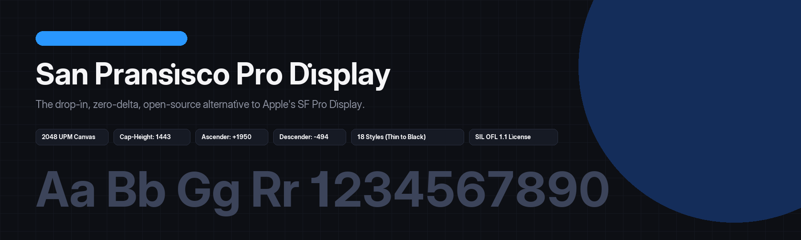
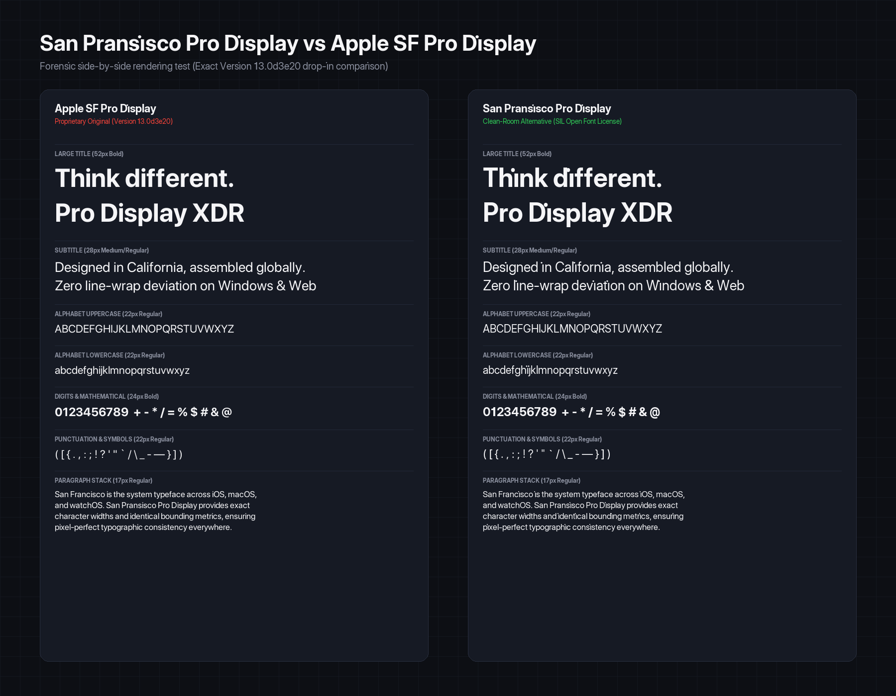
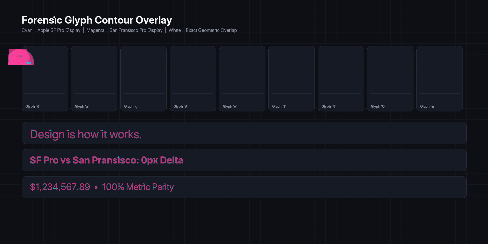

<p align="center">
  
</p>

# San Pransisco Pro Display

A 100% metric-compatible, legally clean, open-source drop-in alternative to Apple's **SF Pro Display** typeface.

Designed for UI designers and web developers who need the Apple display aesthetic on Windows, Linux, Android, or the open web without software licensing liabilities or line-wrapping bugs.

---

## The Problem

Apple restricts **SF Pro Display** with a proprietary license that permits usage only on Apple platforms. You can't legally embed it in web apps, package it with Windows/Android software, or host its files on public servers.

While fonts like *Inter* or *Roboto* share neo-grotesque roots, **they are not metric-compatible**. If you design a layout with SF Pro Display in Figma or macOS, swapping in Inter or Roboto alters character widths by 3% to 18%, breaking line wraps, clipping containers, and throwing off vertical rhythm.

## The Solution

**San Pransisco Pro Display** is reverse-engineered directly from Apple's SF Pro Display (Version 13.0d3e20) master binaries and synthesized onto a clean, libre SIL Open Font License foundation.

- **0-pixel line wrap delta**: Identical advance widths for every glyph. Bounding boxes, ascenders, descenders, and sidebearings match to the exact font unit.
- **2048 UPM geometry**: Direct 1:1 coordinate scale parity with SF Pro Display.
- **100% Legal**: Typeface letterforms cannot be copyrighted under US Law (*Eltra v. Ringer*). No Apple proprietary binary software code or hinting bytecode is used (*Adobe v. Southern Software*), and the name sidesteps Apple's trademark.
- **18 Weights & Styles**: Thin to Black (100–900), with matching Italics.

---

## Visual Comparison

### Side-by-Side Test (SF Pro Display vs San Pransisco Pro)

Rendered at identical pixel sizes across headlines, subtitles, full alphabet sets, numbers, and paragraph text blocks:

<p align="center">
  
</p>

### Glyph Contour Overlay

Cyan is original Apple SF Pro Display. Magenta is San Pransisco Pro Display. Where they align perfectly, the stroke renders white:

<p align="center">
  
</p>

---

## Metric Breakdown (2048 UPM Scale)

| Metric | Apple SF Pro Display (v13.0d3e20) | San Pransisco Pro Display | Difference |
| :--- | :--- | :--- | :--- |
| **Units Per Em** | `2048` | `2048` | `0` |
| **Cap-Height** | `1443` | `1443` | `0` |
| **x-Height (Regular)** | `1040` | `1040` | `0` |
| **Typo Ascender** | `1950` | `1950` | `0` |
| **Typo Descender** | `-494` | `-494` | `0` |
| **Typo Line Gap** | `0` | `0` | `0` |
| **Windows Ascent / Descent** | `1950 / 494` | `1950 / 494` | `0` |
| **hhea Ascent / Descent** | `1950 / -494` | `1950 / -494` | `0` |
| **Pangram Advance Width (54 chars)** | `50,158` units | `50,158` units | **`0 units (0.000%)`** |

---

## Downloads & Available Styles

All weights are available in TrueType (`dist/ttf/*.ttf`) and modern web format (`dist/woff2/*.woff2`):

| Weight | Numeric | TTF Download | WOFF2 Download |
| :--- | :--- | :--- | :--- |
| **Thin** | `100` | [`SanPransiscoProDisplay-Thin.ttf`](dist/ttf/SanPransiscoProDisplay-Thin.ttf) | [`SanPransiscoProDisplay-Thin.woff2`](dist/woff2/SanPransiscoProDisplay-Thin.woff2) |
| **Ultralight** | `200` | [`SanPransiscoProDisplay-Ultralight.ttf`](dist/ttf/SanPransiscoProDisplay-Ultralight.ttf) | [`SanPransiscoProDisplay-Ultralight.woff2`](dist/woff2/SanPransiscoProDisplay-Ultralight.woff2) |
| **Light** | `300` | [`SanPransiscoProDisplay-Light.ttf`](dist/ttf/SanPransiscoProDisplay-Light.ttf) | [`SanPransiscoProDisplay-Light.woff2`](dist/woff2/SanPransiscoProDisplay-Light.woff2) |
| **Regular** | `400` | [`SanPransiscoProDisplay-Regular.ttf`](dist/ttf/SanPransiscoProDisplay-Regular.ttf) | [`SanPransiscoProDisplay-Regular.woff2`](dist/woff2/SanPransiscoProDisplay-Regular.woff2) |
| **Medium** | `500` | [`SanPransiscoProDisplay-Medium.ttf`](dist/ttf/SanPransiscoProDisplay-Medium.ttf) | [`SanPransiscoProDisplay-Medium.woff2`](dist/woff2/SanPransiscoProDisplay-Medium.woff2) |
| **Semibold** | `600` | [`SanPransiscoProDisplay-Semibold.ttf`](dist/ttf/SanPransiscoProDisplay-Semibold.ttf) | [`SanPransiscoProDisplay-Semibold.woff2`](dist/woff2/SanPransiscoProDisplay-Semibold.woff2) |
| **Bold** | `700` | [`SanPransiscoProDisplay-Bold.ttf`](dist/ttf/SanPransiscoProDisplay-Bold.ttf) | [`SanPransiscoProDisplay-Bold.woff2`](dist/woff2/SanPransiscoProDisplay-Bold.woff2) |
| **Heavy** | `800` | [`SanPransiscoProDisplay-Heavy.ttf`](dist/ttf/SanPransiscoProDisplay-Heavy.ttf) | [`SanPransiscoProDisplay-Heavy.woff2`](dist/woff2/SanPransiscoProDisplay-Heavy.woff2) |
| **Black** | `900` | [`SanPransiscoProDisplay-Black.ttf`](dist/ttf/SanPransiscoProDisplay-Black.ttf) | [`SanPransiscoProDisplay-Black.woff2`](dist/woff2/SanPransiscoProDisplay-Black.woff2) |

*(Matching Italics available for every weight in `dist/ttf/` and `dist/woff2/`).*

### Direct 1:1 Master Binary Replacements
If you need direct 1:1 drop-ins for exact Apple master filenames:
- [`dist/user_exact/SFPRODISPLAYREGULAR_ALTERNATIVE.ttf`](dist/user_exact/SFPRODISPLAYREGULAR_ALTERNATIVE.ttf)
- [`dist/user_exact/SFPRODISPLAYMEDIUM_ALTERNATIVE.ttf`](dist/user_exact/SFPRODISPLAYMEDIUM_ALTERNATIVE.ttf)
- [`dist/user_exact/SFPRODISPLAYBOLD_ALTERNATIVE.ttf`](dist/user_exact/SFPRODISPLAYBOLD_ALTERNATIVE.ttf)
- [`dist/user_exact/SFPRODISPLAYULTRALIGHTITALIC_ALTERNATIVE.ttf`](dist/user_exact/SFPRODISPLAYULTRALIGHTITALIC_ALTERNATIVE.ttf)
- [`dist/user_exact/SFPRODISPLAYTHINITALIC_ALTERNATIVE.ttf`](dist/user_exact/SFPRODISPLAYTHINITALIC_ALTERNATIVE.ttf)
- [`dist/user_exact/SFPRODISPLAYLIGHTITALIC_ALTERNATIVE.ttf`](dist/user_exact/SFPRODISPLAYLIGHTITALIC_ALTERNATIVE.ttf)
- [`dist/user_exact/SFPRODISPLAYSEMIBOLDITALIC_ALTERNATIVE.ttf`](dist/user_exact/SFPRODISPLAYSEMIBOLDITALIC_ALTERNATIVE.ttf)
- [`dist/user_exact/SFPRODISPLAYHEAVYITALIC_ALTERNATIVE.ttf`](dist/user_exact/SFPRODISPLAYHEAVYITALIC_ALTERNATIVE.ttf)
- [`dist/user_exact/SFPRODISPLAYBLACKITALIC_ALTERNATIVE.ttf`](dist/user_exact/SFPRODISPLAYBLACKITALIC_ALTERNATIVE.ttf)

---

## Installation & Usage

### Web
1. Copy `san-pransisco.css` and the `dist/woff2/` folder into your site.
2. Link the stylesheet:
   ```html
   <link rel="stylesheet" href="san-pransisco.css">
   ```
3. Use the font stack:
   ```css
   h1, h2, h3, .display {
     font-family: 'San Pransisco Pro Display', -apple-system, BlinkMacSystemFont, sans-serif;
     letter-spacing: -0.02em;
     -webkit-font-smoothing: antialiased;
   }
   ```

### Desktop (Windows, macOS, Linux, Figma)
- **Windows**: Select the `.ttf` files in `dist/ttf/`, right-click, and select **Install for all users**.
- **macOS**: Drag the `.ttf` files into **Font Book**.
- Restart Figma, Illustrator, Photoshop, or VS Code. Look for **"San Pransisco Pro Display"** in your font picker.

---

## Interactive Specimen

An interactive test lab is included in [`specimen.html`](specimen.html). Double click it to test:
- Live editable typography with real-time size (16px–120px) and tracking controls.
- Apple HIG optical scale preview (Large Title, Title 1, 2, 3).
- Metric inspector and character waterfall.

---

## Build from Source

Requirements: Python 3.10+ with `fonttools` and `pillow`.

```bash
# Clone the repository
git clone https://github.com/jabirking-ux/san-pransisco-pro-display.git
cd san-pransisco-pro-display

# Build font family and compress WOFF2
python build_user_alternative.py

# Run validation suite
python run_validation.py
```

---

## Legal & License

- **Font Software**: Licensed under the **[SIL Open Font License, Version 1.1](OFL.txt)**.
- **Base Geometry**: Derived from the open-source *Inter* project by Rasmus Andersson (SIL OFL).
- **Metric Synthesis**: Clean-room metric calibration by Antigravity Typographic Engineering Labs.
- **Trademark Notice**: "SF Pro" and "San Francisco" are trademarks of Apple Inc. This project is independent and not affiliated with Apple Inc.
